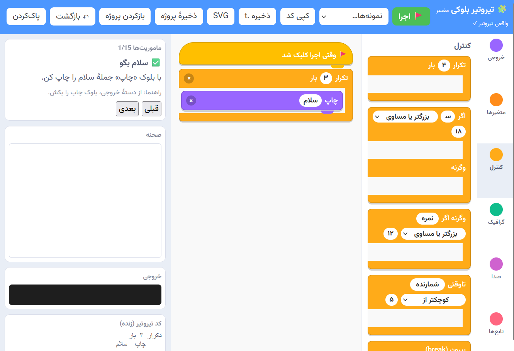

# 🧩 تیروتیر بلوکی (Tirotir Blocks)

محیط برنامه‌نویسی **بلوکی شبیه Scratch** برای زبان فارسی [تیروتیر](https://github.com/worker2025/tirotir). بلوک‌ها را بکشید، کد تیروتیر زنده ببینید و با **مفسر واقعی تیروتیر (v2.0.1)** در مرورگر اجرا کنید (از طریق Pyodide).

*A Scratch-like block editor for the Persian programming language Tirotir. Drag blocks, see live Tirotir code, and run it with the real interpreter in the browser (via Pyodide).*


<div align="center">

# 🧩 تیروتیر بلوکی | Tirotir Blocks

### Visual Programming for Everyone

</div>

<div dir="rtl" align="center">

**برنامه‌نویسی فارسی؛ از بلوک‌های تصویری تا کد واقعی**

محیط برنامه‌نویسی بلوکی برای زبان فارسی تیروتیر؛
بلوک‌ها را کنار هم قرار دهید، کد را زنده ببینید و برنامه خود را اجرا کنید.

</div>

<div align="center">

<a href="https://worker2025.github.io/tirotir-blocks/">
</a>
<a href="https://github.com/worker2025/tirotir-blocks">

</a>
<a href="https://github.com/worker2025/tirotir">

</a>

<br><br>


</div>

---

<div dir="rtl" align="right">

## ✨ برنامه‌نویسی را ببینید، بسازید و اجرا کنید!

تیروتیر بلوکی پلی میان برنامه‌نویسی تصویری و کدنویسی واقعی است. این محیط با الهام از Scratch طراحی شده و امکان ساخت برنامه با بلوک‌های فارسی، مشاهده کد تولیدشده و اجرای آن با مفسر واقعی تیروتیر را فراهم می‌کند.

<div align="center">



<br>

<sub>نمای محیط برنامه‌نویسی بلوکی تیروتیر</sub>

</div>

## 🚀 امکانات

| قابلیت | توضیحات |
|:---|:---|
| 🧱 بلوک‌های تصویری | بیش از ۳۰ بلوک برنامه‌نویسی |
| ⚡ کد زنده | تبدیل بلوک‌ها به کد فارسی تیروتیر |
| 🧠 مفسر واقعی | اجرای برنامه با مفسر تیروتیر در مرورگر |
| 🔁 کنترل جریان | شرط، حلقه و تکرار |
| 🧩 توابع | تعریف و فراخوانی توابع چندورودی |
| 📦 داده‌ها | متغیر، ثابت، فهرست و فرهنگ |
| 🎨 گرافیک | رسم اشکال، حرکت و چرخش |
| 🔊 صدا | تولید صدا با فرکانس و نت‌های موسیقی |
| 💾 ذخیره‌سازی | خروجی SVG، پروژه JSON و کد `.t` |
| 🎓 یادگیری | ۱۵ مأموریت آموزشی و ۸ نمونه آماده |

## 🎯 مناسب برای

- کودکان و نوجوانان علاقه‌مند به برنامه‌نویسی
- دانش‌آموزان و هنرجویان
- مربیان و مدرسان برنامه‌نویسی
- علاقه‌مندان به زبان‌های برنامه‌نویسی فارسی

</div>

<div align="center">

---

### 🧩 از اولین بلوک تا اولین برنامه!

**بلوک بسازید؛ منطق بیاموزید؛ کدنویسی کنید.**

<a href="https://worker2025.github.io/tirotir-blocks/">

</a>

<br><br>

**Developed by Daryoush Alipour**

[Hoosh Masnooe AI Academy](https://tirotir.ir) · [Tirotir Programming Language](https://github.com/worker2025/tirotir)

</div>


## امکانات
- کشیدن و رها کردن (ماوس و لمس)، بلوک‌های تو در تو، بازگشت (`Ctrl+Z`)، ذخیرهٔ خودکار
- ۳۰+ بلوک: چاپ، `بخوان`، متغیر، `ثابت`، فهرست، فرهنگ، `طول`، `محاسبه`، **فرمول** (با فرمول‌های آماده مثل °C↔°F)
- کنترل: `تکرار`، `برای هر`، `تاوقتی`، `اگر / وگرنه اگر / وگرنه`، `بیرون`، `ادامه`
- **تابع با چند ورودی** (`الف و ب`) و بلوک `فراخوانی`
- گرافیک (مربع، دایره، مستطیل، مثلث، حرکت، چرخش، قلم بالا/پایین) و صدا (فرکانس یا نام نت: دو، ر، می…)
- ۱۵ ماموریت آموزشی، ۸ نمونه، ذخیره SVG، ذخیره/بازکردن پروژه (`.json`) و خروجی `.t`
- حالت تیره/روشن خودکار، راست‌به‌چپ

## اجرا
**روی GitHub Pages:** در مخزن → Settings → Pages → Source: *GitHub Actions* (workflow آماده در `.github/workflows/pages.yml` است) یا Branch `main` / root.

**محلی:**
```bash
python -m http.server 8000   # سپس http://localhost:8000
```
> برای مفسر واقعی اینترنت لازم است (Pyodide از CDN بارگذاری می‌شود). بدون آن، صفحه به **پیش‌نمایش ساده** (شبیه‌ساز جاوااسکریپت برای بلوک‌های پایه) برمی‌گردد؛ بلوک‌های `بخوان`، فهرست، فرهنگ، حلقهٔ `برای هر/تاوقتی` و گرافیک‌های جدید فقط با مفسر واقعی اجرا می‌شوند. وضعیت بالای صفحه نشان می‌دهد کدام حالت فعال است.

## به‌روزرسانی مفسر
مفسر تیروتیر داخل `index.html` جاسازی شده است. برای نسخهٔ جدید:
```bash
python tools/sync_interpreter.py /path/to/tirotir/src/tirotir
```

## تست
```bash
pip install playwright && playwright install chromium
PYTHONPATH=/path/to/tirotir/src python tests/smoke_test.py
```

## محدودیت‌های شناخته‌شده
- تابع بدون ورودی را مفسر نمی‌تواند به‌صورت دستور صدا بزند؛ هر تابع دست‌کم یک ورودی بگیرد.
- مفسر `نا برابر با` را درست نمی‌خواند؛ بلوک‌ها از `!=` استفاده می‌کنند.
- خروجی اعشاری در نمایش به ۶ رقم گرد می‌شود.
- هنوز نیست: تبدیل کد به بلوک، اجرای مرحله‌ای، بلوک‌های GUI/ماژول، PWA آفلاین.

## مجوز
MIT برای این پروژه. مفسر تیروتیر (MIT، © worker2025) داخل صفحه جاسازی شده؛ ببینید `THIRD_PARTY_LICENSE_tirotir.txt`.
